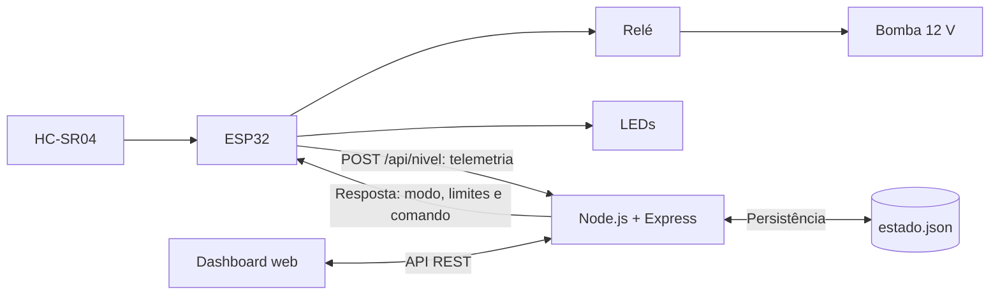

# 🚀 AquaLevel

<div align="center">

**Automação e controle inteligente de reservatórios de água com ESP32 e dashboard web**


[](https://github.com/beasanfer/AquaLevel/stargazers)
[](https://github.com/beasanfer/AquaLevel/network/members)
[](http://makeapullrequest.com)

[Repositório](https://github.com/beasanfer/AquaLevel) · [Reportar Bug](https://github.com/beasanfer/AquaLevel/issues) · [Solicitar Feature](https://github.com/beasanfer/AquaLevel/issues)

</div>

---

## 📋 Sobre o Projeto

O **AquaLevel** é um sistema embarcado de monitoramento e controle do nível de água em reservatórios. Utiliza um **ESP32** e um sensor ultrassônico **HC-SR04** para medir o nível da água, acionar uma bomba por meio de um módulo relé e transmitir telemetria a um servidor web.

Por meio de um dashboard, o usuário acompanha o nível, o volume, a altura da água, o estado da bomba, os limites de operação, o histórico, os alertas e as estatísticas. O sistema pode operar em uma rede local ou comunicar-se com um servidor hospedado no Render.

O projeto busca reduzir desperdícios por transbordamento, diminuir a necessidade de intervenção manual e tornar o acompanhamento do abastecimento mais prático e seguro.

### ✨ Principais Funcionalidades

- 🎯 **Monitoramento contínuo:** medição ultrassônica com filtro de mediana de até sete amostras válidas por ciclo.
- ⚡ **Controle automático local:** acionamento abaixo do mínimo e desligamento ao atingir o máximo, com histerese.
- 🎛️ **Controle manual remoto:** comandos identificados, com expiração e confirmação pela telemetria do ESP32.
- 🔒 **Proteções locais:** limite máximo configurável de 97%, corte fixo de segurança em 98% e desligamento em caso de falha do sensor.
- 🔌 **Comunicação Wi-Fi:** API REST com HTTP na rede local ou HTTPS no Render, com validação de certificados e sincronização NTP.
- 🎨 **Dashboard responsivo:** monitoramento do reservatório, estado confirmado da bomba, limites editáveis, gráfico e eventos.
- 📈 **Históricos e relatórios:** medições, transições da bomba e estatísticas do histórico retido.
- 🚨 **Alertas:** nível crítico, corte de segurança, ESP32 offline e falha no sensor, com separação entre alertas ativos e histórico.
- 💾 **Persistência:** estado, parâmetros e históricos armazenados em `estado.json`.
- ♿ **Acessibilidade:** ajuste do tamanho da fonte e alto contraste, com preferências salvas no navegador.
- 💡 **Indicadores físicos:** três LEDs de nível e um LED de acionamento da bomba.

---

## 🎬 Demonstração

- **Ambiente local:** `http://localhost:3000`
- **Endereço configurado para o Render:** [aqualevel.onrender.com](https://aqualevel.onrender.com/)

### Screenshots

<div align="center">
  
  
</div>

---

## 🏗️ Arquitetura do Sistema



- **Firmware:** mede o nível, calcula o volume, controla o relé e os LEDs e aplica as proteções independentemente do dashboard.
- **Backend:** recebe e valida a telemetria, mantém as configurações, registra eventos, gerencia comandos e monitora a comunicação.
- **Frontend:** consulta a API periodicamente e permite alterar o modo, os limites e solicitar o acionamento manual.

A comunicação entre ESP32 e servidor utiliza o padrão _piggyback_: o firmware envia os dados por `POST /api/nivel` e recebe a configuração e eventuais comandos na resposta da mesma requisição. O servidor não aciona diretamente a bomba.

---

## 🛠️ Tecnologias Utilizadas

### Hardware

- **ESP32-WROOM-32D-N4**: microcontrolador com Wi-Fi.
- **HC-SR04**: sensor ultrassônico de distância.
- **Módulo relé 2 canais 5V 10A com optoacoplador**: acionamento da bomba.
- **Mini bomba d'água 12V RS-385**: bomba utilizada no projeto.
- **Fonte 12V 3A** e **fonte 5V 3A**: alimentação.
- **LEDs** (azul, verde, amarelo, vermelho): indicação de nível e estado da bomba.
- **Resistores, jumpers, protoboard, plugues e abraçadeiras**: montagem e conexão.

### Firmware

- C++ / framework Arduino para ESP32.
- ArduinoJson 7.x.
- WiFi, HTTPClient, WiFiClientSecure e sincronização de horário via NTP.

### Servidor

- Node.js.
- Express (`^5.1.0`).
- API REST e persistência em JSON.
- Render como opção de hospedagem remota.

### Frontend

- HTML5, CSS3 e JavaScript.
- Chart.js (`^4.6.1`), servido localmente pelo backend em `/vendor/chartjs`, sem dependência de CDN.
- Interface de página única (SPA), com navegação entre seis seções.

---

## 🧾 Materiais e Orçamento

A tabela abaixo resume os materiais utilizados no projeto, conforme o orçamento original do projeto.

| **Material**                                   | **Quantidade** | **Preço Final** |
| ---------------------------------------------- | -------------: | --------------: |
| Módulo Relé 2 Canais 5V 10A com optoacoplador  |              1 |        R$ 14,27 |
| Kit jumper 40 fios macho-macho 30 cm           |              1 |        R$ 14,50 |
| Kit jumper 40 fios macho-fêmea 30 cm           |              1 |        R$ 14,50 |
| Kit jumper 40 fios fêmea-fêmea 30 cm           |              1 |        R$ 14,50 |
| Kit jumper 40 fios macho-macho 10 cm           |              1 |        R$ 14,50 |
| Kit jumper 40 fios macho-fêmea 10 cm           |              1 |        R$ 14,50 |
| Kit jumper 40 fios fêmea-fêmea 10 cm           |              1 |        R$ 14,50 |
| Sensor HC-SR04                                 |              1 |        R$ 17,09 |
| Fonte de 12 Volts 3 Amperes                    |              1 |        R$ 17,64 |
| Fonte de 5 Volts 3 Amperes                     |              1 |        R$ 31,31 |
| Plug Borner P4: 2,1x5,5x14 mm                  |              2 |         R$ 7,20 |
| Módulo ESP32-WROOM-32D-N4 38 pinos             |              1 |        R$ 58,90 |
| Protoboard 400 furos                           |              2 |         R$ 6,00 |
| LED Amarelo 5 mm difuso                        |              1 |         R$ 0,80 |
| LED Azul 5 mm difuso                           |              1 |         R$ 0,80 |
| LED Verde 5 mm difuso                          |              1 |         R$ 0,80 |
| LED Vermelho 5 mm difuso                       |              1 |         R$ 0,80 |
| Resistor 220R 1/4W 5%                          |              4 |         R$ 0,80 |
| Resistor 2KR 1/4W 5%                           |              2 |         R$ 0,40 |
| Resistor 1KR 1/4W 5%                           |              1 |         R$ 0,20 |
| Abraçadeira Nylon 100 unidades 3,6 mm x 150 mm |              1 |         R$ 7,50 |
| Mini Bomba d'Água 12V RS-385                   |              1 |        R$ 38,00 |
| Cabo Oberon Micro USB (V8) para USB A          |              1 |        R$ 19,00 |
| **Total**                                      |                |   **R$ 308,51** |

> Valores do orçamento original, podem variar conforme fornecedor e região.

---

## 🚀 Começando

### 📦 Pré-requisitos

- [Node.js](https://nodejs.org/) (versão 18 ou superior, conforme requisito original do projeto).
- [npm](https://www.npmjs.com/) e [Git](https://git-scm.com/).
- [Arduino IDE](https://www.arduino.cc/en/software) com o pacote de placas ESP32.
- Biblioteca **ArduinoJson 7.x**; WiFi, HTTPClient e WiFiClientSecure fornecidos pelo ambiente ESP32.
- Componentes de hardware listados na seção de materiais.

### 💻 Instalação do servidor

```bash
git clone https://github.com/beasanfer/AquaLevel.git
cd AquaLevel
npm install
npm start
```

Acesse `http://localhost:3000` no navegador. A porta padrão é `3000` e pode ser alterada pela variável de ambiente `PORT`. O servidor cria ou restaura `estado.json` na raiz do projeto.

Para hospedagem no Render, utilize `npm install` como comando de instalação das dependências e `npm start` como comando de inicialização. O servidor utiliza a porta informada pelo ambiente. A URL pública deve corresponder à configurada no firmware.

### 🔧 Configuração do firmware ESP32

Abra [`hardware/base/base.ino`](hardware/base/base.ino) e configure a rede e o ambiente de comunicação:

```cpp
const char* WIFI_SSID = "SUA_REDE_WIFI";
const char* WIFI_SENHA = "SUA_SENHA_WIFI";

const bool USAR_RENDER = false;

const char* URL_NIVEL_LOCAL = "http://IP_DO_SERVIDOR:3000/api/nivel";
const char* URL_NIVEL_RENDER = "https://aqualevel.onrender.com/api/nivel";
const char* URL_NIVEL = USAR_RENDER ? URL_NIVEL_RENDER : URL_NIVEL_LOCAL;
```

| `USAR_RENDER` | Ambiente       | Comunicação                                                   |
| ------------- | -------------- | ------------------------------------------------------------- |
| `false`       | Servidor local | HTTP, usando o IP do computador e a porta do servidor         |
| `true`        | Render         | HTTPS, com certificados de confiança e horário obtido por NTP |

> Não utilize `localhost` como endereço do servidor no ESP32. Na operação local, utilize o IP acessível pela rede e permita o acesso à porta do servidor.

No ambiente remoto, o firmware utiliza `WiFiClientSecure` com raízes de confiança incorporadas. Aguarda a sincronização do horário via NTP antes da comunicação HTTPS. Caso a cadeia de certificação do provedor mude, atualize as raízes confiáveis; não desative a validação de certificados.

### 📐 Parâmetros do reservatório

Os valores abaixo correspondem à configuração atual do protótipo no firmware:

```cpp
const float ALTURA_RESERVATORIO_CM = 23.3f;
const float GAP_SENSOR_CM = 0.0f;
const float CAPACIDADE_LITROS = 2.0f;
const float NIVEL_CORTE_SEGURANCA = 98.0f;

const int NUMERO_AMOSTRAS = 7;
const unsigned long INTERVALO_LEITURA_MS = 1000UL;

// Limites iniciais do firmware
float nivelMinimo = 30.0f;
float nivelMaximo = 90.0f;
```

| Parâmetro                | Valor atual | Significado                                                            |
| ------------------------ | ----------: | ---------------------------------------------------------------------- |
| `ALTURA_RESERVATORIO_CM` |     23,3 cm | Distância do sensor ao fundo, com reservatório vazio                   |
| `GAP_SENSOR_CM`          |      0,0 cm | Distância de referência entre o sensor e a superfície no nível de 100% |
| `CAPACIDADE_LITROS`      |         2 L | Capacidade configurada                                                 |
| `nivelMinimo`            |         30% | Limite inicial inferior                                                |
| `nivelMaximo`            |         90% | Limite inicial superior                                                |
| `NIVEL_CORTE_SEGURANCA`  |         98% | Corte fixo local, também adotado como referência pelo backend          |

Ajuste a geometria de acordo com a montagem real, respeitando `0 ≤ GAP_SENSOR_CM < ALTURA_RESERVATORIO_CM` e capacidade positiva. O volume calculado pressupõe relação linear entre altura útil e volume. O gap de zero é o valor configurado no código, não uma garantia de leitura do sensor a distância zero; calibre-o para a montagem e a faixa útil do sensor.

O ESP32 é a fonte dos parâmetros físicos. Ele envia altura, gap e capacidade no primeiro registro e após falhas de comunicação, até receber confirmação do servidor. A API pode solicitar o reenvio. O servidor importa os limites iniciais do ESP32 quando não possui configuração salva; limites personalizados persistidos são preservados. A interface aguarda a primeira telemetria válida de cada execução do servidor para disponibilizar a edição dos limites.

### 📌 Pinagem utilizada no firmware

| Componente      | GPIO ESP32 | Função                                  |
| --------------- | ---------: | --------------------------------------- |
| HC-SR04 TRIG    |         13 | Disparo ultrassônico                    |
| HC-SR04 ECHO    |         35 | Recepção do eco                         |
| Relé da bomba   |         19 | Controle do acionamento                 |
| LED da bomba    |          4 | Indicação de acionamento                |
| LED nível baixo |         18 | Nível abaixo do mínimo                  |
| LED nível médio |         17 | Nível entre mínimo e máximo (exclusive) |
| LED nível cheio |         16 | Nível igual ou superior ao máximo       |

O firmware está configurado com `RELE_ATIVO_EM_LOW = true`, ou seja, relé ativo em nível lógico baixo. Ajuste conforme o módulo utilizado. Consulte também a [tabela de pinos](docs/tabela_pinos/pinos.md).

> Confira a montagem e a compatibilidade dos níveis elétricos antes de energizar o circuito, em especial a adaptação do ECHO do HC-SR04 para o ESP32. Valide o estado do relé durante a energização, inclusive antes do `setup()`.

### ▶️ Gravação do ESP32

1. Abra `hardware/base/base.ino` na Arduino IDE.
2. Selecione a placa ESP32 e a porta serial correspondentes.
3. Instale a biblioteca ArduinoJson 7.x e configure o firmware.
4. Compile e grave o firmware.
5. Abra o Monitor Serial em `115200` baud para acompanhar leituras, estado da bomba, modo e comunicação.
6. Verifique se a interface recebe a telemetria e apresenta os limites e os parâmetros do reservatório.

---

## 📖 Como Usar

### Dashboard

| Página            | Funcionalidade                                                                                                                                                                                         |
| ----------------- | ------------------------------------------------------------------------------------------------------------------------------------------------------------------------------------------------------ |
| **Dashboard**     | Nível percentual, volume em mL, capacidade em litros, altura estimada da água, horários, bomba, controles, limites, alertas ativos, gráfico das últimas 20 leituras e cinco eventos recentes da bomba. |
| **Histórico**     | Tabela de até 1.000 medições recentes, com data, hora, nível, volume em litros, estado da bomba e modo reportado.                                                                                      |
| **Alertas**       | Alertas ativos e histórico de ocorrências, consultados independentemente.                                                                                                                              |
| **Configurações** | Consulta dos limites vigentes, banda de operação e modo atual.                                                                                                                                         |
| **Relatórios**    | Níveis médio, máximo e mínimo e quantidade de acionamentos registrados.                                                                                                                                |
| **Sobre**         | Informações sobre o projeto e suas tecnologias.                                                                                                                                                        |

Os limites são editados no Dashboard, por meio dos controles deslizantes e dos botões **Salvar limites** e **Cancelar edição**. O rascunho não é sobrescrito pelas atualizações periódicas. A interface diferencia a hora da última medição válida da hora de atualização do painel.

### Medição do nível

O HC-SR04 realiza até sete tentativas de leitura por ciclo, com 60 ms entre as amostras e timeout de eco de 30 ms. As leituras válidas são ordenadas e o firmware utiliza a mediana (a mediana superior quando a quantidade é par). O intervalo mínimo entre inícios de ciclos é de 1 segundo; requisições de rede podem prolongá-lo.

```text
Distância (cm) = duração do eco (µs) × 0,0343 / 2
Nível (%) = (altura do reservatório − distância) / (altura do reservatório − gap) × 100
Volume (L) = nível (%) × capacidade (L) / 100
Altura da água (cm) = nível (%) × (altura do reservatório − gap) / 100
```

O nível é limitado ao intervalo de 0% a 100%. Se nenhuma amostra for válida, o firmware reporta `nivel: -1`, desliga a bomba e apaga os LEDs.

### Modo automático

O controle ocorre no próprio ESP32, com histerese:

- Bomba desligada e `nível < mínimo`: liga.
- Bomba ligada e `nível >= máximo`: desliga.
- `mínimo <= nível < máximo`: mantém o estado anterior.

A banda de operação é a diferença entre máximo e mínimo, em pontos percentuais. Os limites devem respeitar `1 <= mínimo < máximo <= 97`. O painel usa valores inteiros nos controles deslizantes. Os valores iniciais do firmware são 30% e 90%.

Em uma perda de comunicação, o modo automático pode continuar operando localmente com os últimos limites válidos, desde que o sensor esteja funcional e não exista bloqueio de recuperação após falha do sensor.

### Modo manual

Ao selecionar **Manual**, o servidor registra o modo solicitado e o ESP32 desliga a bomba ao efetivamente entrar nesse modo. Use os botões **Ligar bomba** e **Desligar bomba** para enviar novos comandos.

- O acionamento exige comunicação válida, sensor operacional, sessão identificada e nível abaixo do máximo configurado.
- Cada comando recebe um ID único, expira em 10 segundos se não confirmado e não é reaplicado pelo firmware quando o ID já foi processado.
- O servidor entrega o comando na resposta de `POST /api/nivel`; o processamento é informado em telemetria posterior.
- O painel distingue a intenção (`bombaDesejada`), o comando pendente (`comandoPendente`) e o estado confirmado (`bombaConfirmada`). A confirmação corresponde ao estado reportado pelo firmware, não a uma medição independente de vazão ou corrente da bomba.
- O botão de desligamento permanece disponível no modo manual mesmo quando o ESP32 está offline ou há uma solicitação de ligar em andamento (exceto durante outra solicitação de desligar ou mudança de modo). Uma solicitação aceita não garante desligamento físico imediato sem comunicação.
- Em caso de perda de comunicação ou falha do sensor, o firmware desliga a bomba no modo manual e sinaliza bloqueio. Comandos antigos são descartados quando o servidor detecta o bloqueio ou uma nova sessão do ESP32; é necessário emitir novo comando válido para retomar o controle manual.

### Indicadores físicos e alertas

| Indicador LED | Condição                                            |
| ------------- | --------------------------------------------------- |
| Baixo         | Nível abaixo do mínimo                              |
| Médio         | Nível maior ou igual ao mínimo e menor que o máximo |
| Cheio         | Nível maior ou igual ao máximo configurado          |
| Bomba         | Acionamento do relé reportado pelo firmware         |

| Tipo de alerta    | Condição                                                                                                    |
| ----------------- | ----------------------------------------------------------------------------------------------------------- |
| `nivel_critico`   | Nível abaixo do mínimo; resolvido quando volta a atingir o mínimo.                                          |
| `corte_seguranca` | Em modo manual, nível igual ou superior ao máximo e bomba reportada ligada; servidor solicita desligamento. |
| `esp32_offline`   | Mais de 15 segundos sem telemetria válida do ESP32.                                                         |
| `sensor_falha`    | ESP32 comunica que não obteve leitura válida (`nivel: -1`).                                                 |

Os alertas ativos não são duplicados enquanto a condição permanece ativa. Quando resolvidos, são removidos da lista de ativos, mas suas ocorrências permanecem no histórico dentro do limite de retenção. O indicador de conexão diferencia servidor indisponível, ESP32 offline, sensor com falha e operação conectada.

---

## 🔌 API REST

As rotas são disponibilizadas pelo servidor Express. O dashboard utiliza URLs relativas, funcionando no mesmo domínio do backend tanto localmente quanto no Render.

### Endpoints disponíveis

| Método | Endpoint               | Descrição                                                                                       |
| ------ | ---------------------- | ----------------------------------------------------------------------------------------------- |
| `POST` | `/api/nivel`           | Recebe telemetria, registra parâmetros e retorna modo, limites e eventual comando manual.       |
| `GET`  | `/api/status`          | Consulta o estado do sistema, incluindo confirmação da bomba, comunicação, sensor e geometria.  |
| `GET`  | `/api/comando`         | Consulta estado, intenção, pendência, modo e limites para diagnóstico.                          |
| `POST` | `/api/bomba`           | Solicita ligar ou desligar no modo manual.                                                      |
| `POST` | `/api/modo`            | Altera o modo para `automatico` ou `manual`.                                                    |
| `POST` | `/api/limites`         | Atualiza os limites após sincronização inicial.                                                 |
| `GET`  | `/api/historico`       | Retorna até 1.000 medições recentes; aceita `?limite=N` (inteiro positivo, limitado a 1.000).   |
| `GET`  | `/api/historico-bomba` | Retorna o histórico de transições reportadas da bomba.                                          |
| `GET`  | `/api/alertas`         | Retorna o histórico de alertas registrados.                                                     |
| `GET`  | `/api/alertas/ativos`  | Retorna condições ainda não resolvidas.                                                         |
| `GET`  | `/api/estatisticas`    | Retorna níveis médio, máximo e mínimo, consumo estimado, acionamentos e quantidade de amostras. |

### Telemetria do ESP32

Exemplo de corpo JSON enviado ao `POST /api/nivel` no registro inicial, com parâmetros físicos e limites do protótipo:

```json
{
  "nivel": 72.5,
  "litros": 1.45,
  "bombaLigada": false,
  "modoESP32": "automatico",
  "sessaoESP32": "a1b2c3d4-e5f67890",
  "comandoAplicadoId": "",
  "bloqueioManual": false,
  "minimoInicial": 30,
  "maximoInicial": 90,
  "alturaCm": 23.3,
  "gapSensorCm": 0.0,
  "capacidadeLitros": 2.0
}
```

Os campos `nivel`, `litros` e `bombaLigada` representam a medição e o estado reportado; `modoESP32` informa o modo efetivo. `sessaoESP32` identifica a inicialização do dispositivo e `comandoAplicadoId` informa o último comando processado. A geometria é enviada quando seu registro está pendente. Os limites iniciais são obrigatórios quando ainda não existe configuração válida no servidor.

Exemplo de resposta em operação automática, após registrar os parâmetros:

```json
{
  "sucesso": true,
  "modo": "automatico",
  "minimo": 30,
  "maximo": 90,
  "bombaLigada": false,
  "comandoManual": null,
  "parametrosRecebidos": true,
  "solicitarParametros": false
}
```

Quando há um comando manual pendente entregável à sessão atual, `comandoManual` contém `id` e `ligar`. O campo `bombaLigada` da resposta é informativo, não uma ordem para energizar o relé.

A falha de sensor é reportada com `nivel: -1`, `litros: 0` e `bombaLigada: false`. O servidor responde com HTTP 200, `sucesso: false` e `sensorOK: false`, mantém a última medição válida e pode devolver a configuração, sem comando manual.

### Exemplos de API

> Execute as consultas livremente em ambiente de teste. As solicitações de alteração podem modificar o funcionamento de um atuador físico; teste somente em instalação controlada. Não envie telemetria simulada ao servidor que estiver controlando um ESP32 real.

**Consultar status, histórico e alertas ativos:**

```bash
curl http://localhost:3000/api/status
curl "http://localhost:3000/api/historico?limite=20"
curl http://localhost:3000/api/alertas/ativos
curl http://localhost:3000/api/estatisticas
```

**Selecionar modo manual:**

```bash
curl -X POST http://localhost:3000/api/modo \
  -H "Content-Type: application/json" \
  -d '{"modo":"manual"}'
```

**Solicitar acionamento ou desligamento da bomba:**

```bash
curl -X POST http://localhost:3000/api/bomba \
  -H "Content-Type: application/json" \
  -d '{"ligar":true}'

curl -X POST http://localhost:3000/api/bomba \
  -H "Content-Type: application/json" \
  -d '{"ligar":false}'
```

**Salvar limites:**

```bash
curl -X POST http://localhost:3000/api/limites \
  -H "Content-Type: application/json" \
  -d '{"minimo":30,"maximo":90}'
```

As rotas de modo e bomba também aceitam `clienteControleId` e `sequenciaControle` para ordenar solicitações do mesmo painel. O frontend usa essa identificação para evitar que um pedido antigo de ligar reverta um desligamento mais recente. Os exemplos simples, sem esses campos, são compatíveis com a API, mas não possuem essa garantia de ordenação.

A API utiliza HTTP 400 para dados ou operações inválidas e HTTP 409 para conflitos, ausência de sincronização ou acionamento sem comunicação/sensor válidos. Uma resposta HTTP de sucesso a um comando não significa confirmação física: consulte `/api/status`.

---

## 💾 Persistência, Histórico e Atualizações

O servidor mantém o arquivo `estado.json`, com as coleções `sistema`, `historico`, `historicoBomba`, `alertas` e `alertasAtivos`. O salvamento utiliza `estado.json.tmp` seguido de renomeação no mesmo sistema de arquivos. Ocorre periodicamente a cada 60 segundos, em eventos relevantes e no encerramento por `SIGINT` ou `SIGTERM`.

| Recurso                                                 | Limite ou intervalo                                                                                    |
| ------------------------------------------------------- | ------------------------------------------------------------------------------------------------------ |
| Histórico de medições em memória e no arquivo           | 5.000 registros                                                                                        |
| Histórico retornado pela API                            | Até 1.000 registros recentes                                                                           |
| Histórico de transições da bomba                        | 500 registros                                                                                          |
| Alertas                                                 | Até 200 por coleção (ativos e histórico)                                                               |
| Gráfico do Dashboard                                    | Até 20 medições recentes                                                                               |
| Últimos eventos no Dashboard                            | Até 5 transições                                                                                       |
| Alertas ativos no Dashboard                             | Até 2 (lista completa na página Alertas)                                                               |
| Polling de status, gráfico e alertas ativos             | 2 segundos                                                                                             |
| Polling de eventos, estatísticas e histórico de alertas | 5 segundos                                                                                             |
| Atualização periódica da tabela de medições             | 5 segundos quando a página Histórico está ativa                                                        |
| Timeout das consultas do frontend                       | 15 segundos                                                                                            |
| Watchdog do ESP32                                       | Mais de 15 segundos sem POST válido, verificado a cada 5 segundos e em consultas/operações específicas |
| Validade de comando manual pendente                     | 10 segundos                                                                                            |

As estatísticas consideram o histórico retido, não todo o período de uso do sistema. O consumo estimado é a soma das reduções de volume entre amostras válidas consecutivas, arredondada em litros; não equivale a uma medição direta de vazão ou consumo. Os acionamentos são contados a partir das transições para o estado ligado registradas no histórico da bomba.

Comandos manuais pendentes não são restaurados após reinício. O servidor preserva a última leitura histórica, mas só volta a confirmar o estado da bomba ao receber nova telemetria.

---

## 🗂️ Estrutura de Pastas

```text
AquaLevel/
├── docs/
│   ├── screenshots/
│   │   ├── alertas.png
│   │   └── dashboard.png
│   └── tabela_pinos/
│       └── pinos.md
├── hardware/
│   ├── base/
│   │   ├── base.ino
│   │   └── problemas_observados.md
│   └── teste/
│       ├── componente/
│       │   ├── descricao.md
│       │   ├── bomba/
│       │   │   ├── apenas_bomba/
│       │   │   └── bomba_rele/
│       │   ├── hcsr/
│       │   │   ├── arduino/
│       │   │   ├── esp32/
│       │   │   └── sem_media/
│       │   ├── led/
│       │   │   ├── externo/
│       │   │   └── interno/
│       │   └── monitor_serial/
│       └── funcionalidade/
│           ├── descricao.md
│           ├── local/
│           │   └── modo_automatico/
│           └── remoto/
│               └── conexao/
│                   ├── rest/
│                   └── temporario/
├── public/
│   ├── icons/
│   ├── index.html
│   ├── script.js
│   └── style.css
├── estado.json
├── package.json
├── package-lock.json
├── server.js
└── README.md
```

A pasta `node_modules/` é gerada pela instalação das dependências e foi omitida da árvore para simplificar a leitura. O arquivo `estado.json` é gerado/atualizado em tempo de execução e não precisa ser versionado.

---

## 🧪 Testes

O repositório contém sketches e análises de testes de componentes e funcionalidades em [`hardware/teste/`](hardware/teste/). O `package.json` não define `npm test` nem uma suíte de testes automatizados.

### Testes manuais recomendados

| Cenário                                               | Resultado esperado                                                                                                                  |
| ----------------------------------------------------- | ----------------------------------------------------------------------------------------------------------------------------------- |
| Inicialização do servidor e ESP32                     | Telemetria, geometria e limites sincronizados; estado da bomba informado pelo ESP32.                                                |
| Nível abaixo do mínimo, modo automático               | Bomba acionada e LED de nível baixo ligado.                                                                                         |
| Nível na banda de operação                            | Estado anterior da bomba preservado no modo automático.                                                                             |
| Nível igual ou superior ao máximo                     | Bomba desligada nos dois modos.                                                                                                     |
| Mudança para manual                                   | Bomba desligada ao entrar no modo; novo comando necessário para ligar.                                                              |
| Comando manual válido                                 | Intenção pendente até o ESP32 reportar o processamento e o estado resultante.                                                       |
| Comandos de ligar e desligar concorrentes no painel   | Pedido mais antigo não sobrescreve o mais recente aceito, para o mesmo cliente de controle.                                         |
| Limites inválidos ou máximo acima de 97%              | Alteração rejeitada.                                                                                                                |
| Falha do HC-SR04                                      | Bomba e LEDs desligados; alerta de sensor; última leitura válida preservada.                                                        |
| Recuperação do sensor                                 | Retomada condicionada a sincronização válida com o servidor.                                                                        |
| Queda de Wi-Fi ou da API em modo manual               | Bomba desligada pelo firmware ao detectar a falha; novo comando necessário após recuperação.                                        |
| Perda de telemetria por mais de 15 s                  | Watchdog sinaliza ESP32 offline e estado da bomba sem confirmação.                                                                  |
| Queda de comunicação em automático, com sensor válido | Controle local continua com os últimos limites válidos, salvo bloqueio após falha de sensor.                                        |
| Reinício do servidor                                  | Históricos e limites salvos restaurados; comandos antigos não restaurados e estado físico desconhecido até nova telemetria.         |
| Reinício do ESP32                                     | Relé inicializado desligado no `setup()`, nova sessão identificada e comandos da sessão anterior invalidados ao detectar a mudança. |
| Comunicação com Render                                | HTTPS validado após sincronização de horário; sem uso de `setInsecure()`.                                                           |

Realize os testes de proteções e limites em ambiente controlado, preferencialmente com a carga desconectada ou simulação isolada antes de utilizar a bomba real. Os resultados acima são comportamentos esperados pelo código, não um registro de testes executados.

---

## 🔒 Regras de Controle e Segurança

- **Autoridade local:** o ESP32 controla o relé e aplica o máximo configurado e o corte fixo em 98%, inclusive em modo manual. O backend valida solicitações, mas não substitui o controle local.
- **Falha do sensor:** o firmware desliga a bomba, apaga os LEDs e aguarda sincronização válida antes de retomar a operação após a recuperação do sensor.
- **Falha de comunicação:** o modo manual é interrompido localmente quando a falha é detectada; o automático pode continuar com os últimos limites válidos, respeitando as proteções.
- **Watchdog:** ausência de telemetria marca `esp32Online = false` e `bombaConfirmada = null`, sem alterar artificialmente `sensorOK` ou registrar um desligamento físico que não foi reportado.
- **Reinícios:** o servidor descarta comandos pendentes e não presume que a bomba esteja desligada. O ESP32 inicializa o relé desligado no `setup()`, podendo retomar o automático conforme o nível e a configuração; uma nova sessão invalida comandos anteriores quando detectada pelo backend.
- **HTTPS:** a comunicação remota valida certificado e horário. A sessão do ESP32 e a identificação do cliente de controle não constituem autenticação.

### Limitações conhecidas

- A implementação atual não possui autenticação ou autorização nas rotas da API. Não exponha o controle de um atuador físico à internet sem proteção de acesso apropriada. HTTPS protege o transporte, mas não autentica os usuários nem o ESP32 perante a API.
- O armazenamento em `estado.json` depende da durabilidade do disco. Em hospedagem com sistema de arquivos efêmero, dados podem ser perdidos em reinícios ou novas implantações. A gravação síncrona também pode bloquear temporariamente o event loop do servidor.
- A confirmação da bomba representa o estado do GPIO reportado pelo firmware, não verifica se a bomba efetivamente está girando ou se há fluxo de água.
- A segurança antes da execução do `setup()` depende do circuito do relé; o software não substitui proteções elétricas ou físicas independentes.
- Os intervalos de atualização e watchdog não garantem resposta em tempo real estrito. A medição e a comunicação HTTP/HTTPS podem prolongar o ciclo de controle.

---

## 🤝 Contribuindo

Contribuições são bem-vindas.

1. Faça um Fork do projeto.
2. Crie uma Branch para a sua Feature:
   ```bash
   git checkout -b feature/MinhaFeature
   ```
3. Commit as suas mudanças:
   ```bash
   git commit -m 'Adiciona MinhaFeature'
   ```
4. Push para a Branch:
   ```bash
   git push origin feature/MinhaFeature
   ```
5. Abra um Pull Request.

---

## 📄 Licença

Licença indicada na documentação original: **MIT**.

---

## 👨‍💻 Autores

**Alex de Lima Rodrigues**
Discente do Curso de Bacharel em Engenharia da Computação — Faculdade Fametro
GitHub: [@yellowperson12](https://github.com/yellowperson12)
LinkedIn: https://www.linkedin.com/in/alex-rodrigues-965b59392/

**Beatriz Santos Ferreira**
Discente do Curso de Bacharel em Engenharia da Computação — Faculdade Fametro
GitHub: [@beasanfer](https://github.com/beasanfer)
LinkedIn: https://www.linkedin.com/in/beatriz-santos-476587222

**Luana Magalhães Leal**
Docente do Curso de Bacharel em Engenharia da Computação — Faculdade Fametro
GitHub: [@ProfaLuanaLeal](https://github.com/ProfaLuanaLeal)
LinkedIn: https://www.linkedin.com/in/luanalealm/

---

## 🙏 Agradecimentos

- À Faculdade Fametro e ao curso de Engenharia da Computação.
- À orientadora Luana Magalhães Leal.
- A todos que contribuíram com testes, montagem e revisão do projeto.

---

<div align="center">

**⭐ Se este projeto foi útil, considere dar uma estrela!**

Made with ❤️ by AquaLevel Team

</div>
