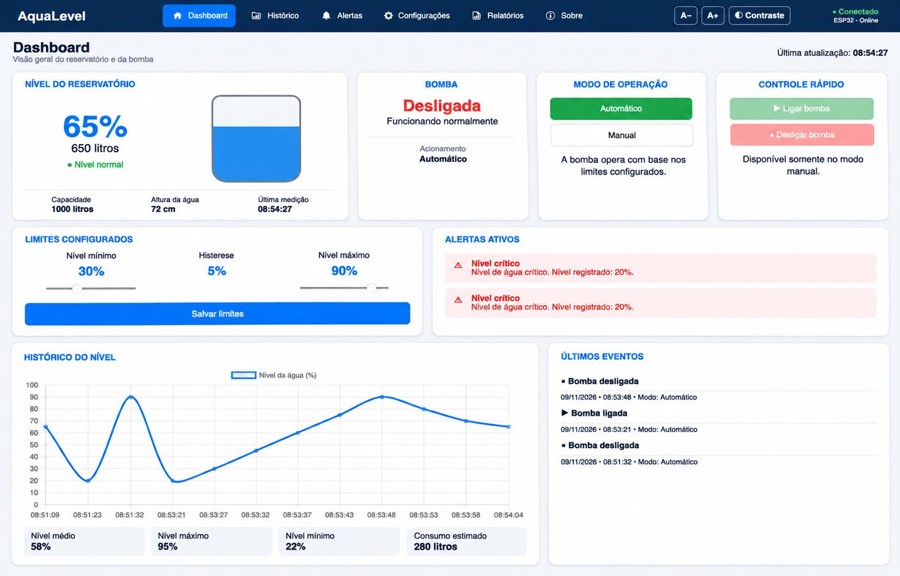
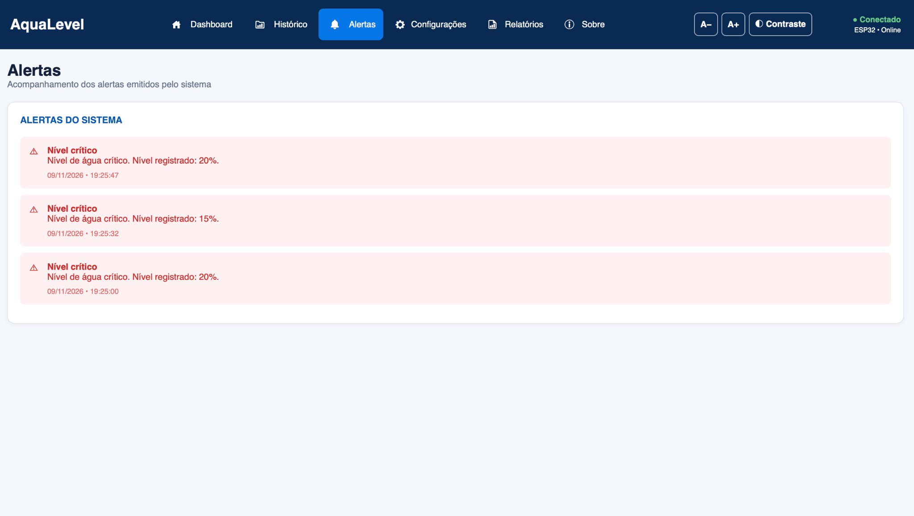

# 🚀 AquaLevel

<div align="center">


**Automação e controle inteligente de reservatórios de água com ESP32 e dashboard web**

[](https://github.com/beasanfer/AquaLevel/blob/main/LICENSE)
[](https://github.com/beasanfer/AquaLevel/stargazers)
[](https://github.com/beasanfer/AquaLevel/network/members)
[](http://makeapullrequest.com)

[Repositório](https://github.com/beasanfer/AquaLevel) · [Reportar Bug](https://github.com/beasanfer/AquaLevel/issues) · [Solicitar Feature](https://github.com/beasanfer/AquaLevel/issues)

</div>

---

## 📋 Sobre o Projeto

O **AquaLevel** é um sistema embarcado de monitoramento e controle de nível de água em reservatórios. Ele utiliza um **ESP32** e um sensor ultrassônico **HC-SR04** para medir o nível da água, acionar uma bomba por meio de um módulo relé e enviar os dados para um servidor web. O usuário acompanha tudo por um **dashboard** com nível, volume, estado da bomba, limites, histórico, alertas e eventos.

O projeto busca reduzir desperdícios por transbordamento, diminuir a necessidade de intervenção manual e tornar o acompanhamento do abastecimento mais prático e seguro.

### ✨ Principais Funcionalidades

- 🎯 **Monitoramento contínuo do nível** — leituras do HC-SR04 com filtragem por mediana.
- ⚡ **Controle automático da bomba** — liga abaixo do nível mínimo e desliga acima do nível máximo.
- 🔒 **Corte de segurança** — a bomba é desligada em nível crítico (≥ 98%), inclusive em modo manual.
- 🎨 **Dashboard web** — nível percentual, litros, altura da água, estado da bomba e modo de operação.
- 📈 **Histórico e gráfico** — registros de medições, acionamentos da bomba e visualização com Chart.js.
- 🚨 **Alertas** — nível crítico, corte de segurança e ESP32 offline.
- 🔌 **Comunicação Wi-Fi/HTTP** — o ESP32 envia leituras e recebe comandos na mesma requisição (*piggyback*).
- 💾 **Persistência de estado** — estado salvo em `estado.json` no servidor.
- ♿ **Acessibilidade** — ajuste de fonte e alto contraste no dashboard.
- 💡 **Indicadores físicos** — LEDs de nível e LED de estado da bomba.

---

## 🎬 Demonstração

### Screenshots

<div align="center">
  
  
</div>

---

## 🛠️ Tecnologias Utilizadas

### Hardware
- **ESP32-WROOM-32D-N4** — microcontrolador com Wi-Fi.
- **HC-SR04** — sensor ultrassônico de distância.
- **Módulo relé 2 canais 5V 10A com optoacoplador** — acionamento da bomba.
- **Mini bomba d'água 12V RS-385** — bomba utilizada no projeto.
- **Fonte 12V 3A** e **fonte 5V 3A** — alimentação.
- **LEDs** — indicação física de nível e estado da bomba.
- **Resistores, jumpers, protoboard, plugues e abraçadeiras** — montagem e conexão.

### Firmware
- **Arduino/C++**
- **WiFi.h**
- **HTTPClient.h**
- **ArduinoJson**
- **pulseIn** para leitura do HC-SR04

### Servidor
- **Node.js** (18+)
- **Express 5**
- **JSON** para persistência em `estado.json`

### Frontend
- **HTML5**
- **CSS3**
- **JavaScript**
- **Chart.js** para gráfico de nível

---

## 🧾 Materiais e Orçamento

A tabela abaixo resume os materiais utilizados no projeto, conforme orçamento levantado.

| **Material**                                   | **Quantidade** | **Preço Final** |
|------------------------------------------------|---------------:|----------------:|
| Módulo Relé 2 Canais 5V 10A com optoacoplador  |              1 |        R$ 14,27 |
| Kit jumper 40 fios macho-macho 30 cm           |              1 |        R$ 14,50 |
| Kit jumper 40 fios macho-fêmea 30 cm           |              1 |        R$ 14,50 |
| Kit jumper 40 fios fêmea-fêmea 30 cm           |              1 |        R$ 14,50 |
| Kit jumper 40 fios macho-macho 10 cm           |              1 |        R$ 14,50 |
| Kit jumper 40 fios macho-fêmea 10 cm           |              1 |        R$ 14,50 |
| Kit jumper 40 fios fêmea-fêmea 10 cm           |              1 |        R$ 14,50 |
| Sensor HC-SR04                                 |              1 |        R$ 17,09 |
| Fonte de 12 Volts 3 Amperes                    |              1 |        R$ 17,64 |
| Fonte de 5 Volts 3 Amperes                     |              1 |        R$ 31,31 |
| Plug Borner P4: 2,1x5,5x14 mm                  |              2 |         R$ 7,20 |
| Módulo ESP32-WROOM-32D-N4 38 pinos             |              1 |        R$ 58,90 |
| Protoboard 400 furos                           |              2 |         R$ 6,00 |
| LED Amarelo 5 mm difuso                        |              1 |         R$ 0,80 |
| LED Azul 5 mm difuso                           |              1 |         R$ 0,80 |
| LED Verde 5 mm difuso                          |              1 |         R$ 0,80 |
| LED Vermelho 5 mm difuso                       |              1 |         R$ 0,80 |
| Resistor 220R 1/4W 5%                          |              4 |         R$ 0,80 |
| Resistor 2KR 1/4W 5%                           |              2 |         R$ 0,40 |
| Resistor 1KR 1/4W 5%                           |              1 |         R$ 0,20 |
| Abraçadeira Nylon 100 unidades 3,6 mm x 150 mm |              1 |         R$ 7,50 |
| Mini Bomba d'Água 12V RS-385                   |              1 |        R$ 38,00 |
| Cabo Oberon Micro USB (V8) para USB A          |              1 |        R$ 19,00 |
| **Total**                                      |                |   **R$ 308,51** |

> Valores levantados no orçamento do projeto. Podem variar conforme fornecedor e região.

---

## 🚀 Começando

### 📦 Pré-requisitos

Antes de começar, certifique-se de ter instalado:

- [Node.js](https://nodejs.org/) (versão 18 ou superior)
- [npm](https://www.npmjs.com/)
- [Git](https://git-scm.com/)
- [Arduino IDE](https://www.arduino.cc/en/software) ou PlatformIO
- Pacote de placas **ESP32** na Arduino IDE
- Bibliotecas **ArduinoJson** e **HTTPClient** disponíveis para ESP32
- Componentes de hardware listados na seção de materiais

### 💻 Instalação do servidor

1. **Clone o repositório**

   ```bash
   git clone https://github.com/beasanfer/AquaLevel.git
   ```

2. **Acesse a pasta do projeto**

   ```bash
   cd AquaLevel
   ```

3. **Instale as dependências**

   ```bash
   npm install
   ```

4. **Inicie o servidor**

   ```bash
   npm start
   ```

5. **Acesse no navegador**

   ```text
   http://localhost:3000
   ```

O servidor cria/atualiza o arquivo `estado.json` para persistir o estado do sistema.

### 🔧 Configuração do firmware ESP32

No arquivo `hardware/base/base.ino`, ajuste as credenciais e o endereço do servidor:

```cpp
const char* WIFI_SSID  = "SUA_REDE_WIFI";
const char* WIFI_SENHA = "SUA_SENHA_WIFI";
const char* URL_NIVEL  = "http://IP_DO_SERVIDOR:3000/api/nivel";
```

> ⚠️ Não versione credenciais reais. Substitua os valores de exemplo pelos seus dados e evite publicar segredos no repositório.

Ajuste também os parâmetros físicos do reservatório:

```cpp
float ALTURA_RESERVATORIO_CM = 22.5f; // distância sensor → fundo (tanque vazio)
float GAP_SENSOR_CM          = 5.0f;  // distância mínima sensor ↔ água (tanque cheio)
const float CAPACIDADE_LITROS = 1000.0f;
```

### 📌 Pinagem utilizada no firmware

|Componente|Pino ESP32|
|---|---|
|HC-SR04 TRIG|GPIO 13|
|HC-SR04 ECHO|GPIO 35|
|Relé da bomba|GPIO 19|
|LED da bomba|GPIO 4|
|LED nível 1|GPIO 18|
|LED nível 2|GPIO 17|
|LED nível 3|GPIO 16|

> Confira a pinagem real da sua montagem antes de energizar a bomba e o relé.

### ▶️ Gravação do ESP32

1. Abra `hardware/base/base.ino` na Arduino IDE.
2. Selecione a placa ESP32 correspondente.
3. Instale as bibliotecas necessárias (`ArduinoJson`, etc.).
4. Compile e grave o firmware.
5. Abra o Monitor Serial em `115200` baud para acompanhar leituras, Wi-Fi e comandos.

> O ESP32 e o servidor devem estar na mesma rede Wi-Fi/LAN, ou o endereço `URL_NIVEL` deve apontar para um servidor acessível.

---

## 📖 Como Usar

### Dashboard

Acesse `http://localhost:3000` e utilize o menu para navegar entre:

- **Dashboard** — nível, litros, bomba, modo, limites, gráfico e eventos.
- **Histórico** — tabela de medições.
- **Alertas** — alertas emitidos pelo sistema.
- **Configurações** — limites e modo atual.
- **Relatórios** — resumo de indicadores.
- **Sobre** — informações do projeto.

### Modo automático

No modo automático, o controle segue as regras:

- Se a bomba estiver desligada e `nível < mínimo` → liga a bomba.
- Se a bomba estiver ligada e `nível > máximo` → desliga a bomba.
- Entre mínimo e máximo, a bomba mantém o estado atual (banda de operação).

### Modo manual

No modo manual, o usuário pode ligar/desligar a bomba pelo dashboard, respeitando as proteções:

- Não é permitido ligar a bomba com nível `≥ 98%`.
- Não é permitido ligar a bomba com nível `≥ máximo`.
- Em falha de sensor, a bomba é desligada por segurança.
- Após reinício do servidor, a bomba inicia desligada.

### Exemplos de API

#### Enviar leitura do ESP32

```bash
curl -X POST http://localhost:3000/api/nivel \
  -H "Content-Type: application/json" \
  -d '{"nivel":72.5,"litros":725,"bombaLigada":true}'
```

#### Consultar status

```bash
curl http://localhost:3000/api/status
```

#### Alterar modo

```bash
curl -X POST http://localhost:3000/api/modo \
  -H "Content-Type: application/json" \
  -d '{"modo":"manual"}'
```

#### Ligar/desligar bomba no modo manual

```bash
curl -X POST http://localhost:3000/api/bomba \
  -H "Content-Type: application/json" \
  -d '{"ligar":true}'
```

#### Salvar limites

```bash
curl -X POST http://localhost:3000/api/limites \
  -H "Content-Type: application/json" \
  -d '{"minimo":30,"maximo":90}'
```

### Endpoints disponíveis

|Método|Endpoint|Descrição|
|---|---|---|
|`POST`|`/api/nivel`|Recebe leitura do ESP32 e devolve comandos|
|`GET` |`/api/status`|Retorna o estado atual do sistema|
|`GET` |`/api/comando`|Retorna comando/estado para debug|
|`POST`|`/api/bomba`|Liga/desliga bomba no modo manual|
|`POST`|`/api/modo`|Altera entre `automatico` e `manual`|
|`POST`|`/api/limites`|Atualiza níveis mínimo e máximo|
|`GET`|`/api/historico`|Retorna histórico de medições|
|`GET`|`/api/historico-bomba`|Retorna histórico de acionamentos|
|`GET`|`/api/alertas` |Retorna alertas registrados|

---

## 🗂️ Estrutura de Pastas

```text
AquaLevel/
├── docs/
│   └── screenshots/
│       ├── alertas.png
│       └── dashboard.png
├── hardware/
│   ├── base/
│   │   ├── base.ino
│   │   └── problemas_observados.md
│   └── teste/
│       ├── componente/
│       │   ├── bomba/
│       │   ├── hcsr/
│       │   ├── led/
│       │   └── monitor_serial/
│       └── funcionalidade/
│           ├── local/
│           └── remoto/
├── public/
│   ├── icons/
│   ├── index.html
│   ├── script.js
│   └── style.css
├── package.json
├── package-lock.json
├── server.js
└── README.md
```

> O arquivo `estado.json` é gerado em tempo de execução pelo servidor e não precisa ser versionado.

---

## 🧪 Testes

Atualmente o repositório **não possui uma suíte automatizada de testes configurada**. O script `npm test` não está definido no `package.json`.

### Testes manuais recomendados

1. Subir o servidor com `npm start`.
2. Gravar o firmware no ESP32 e abrir o Monitor Serial.
3. Verificar se o dashboard recebe leituras e atualiza nível/litros.
4. Simular nível abaixo do mínimo e confirmar o acionamento automático da bomba.
5. Simular nível acima do máximo e confirmar o desligamento automático.
6. Alternar para modo manual e testar ligar/desligar pelo dashboard.
7. Testar o corte de segurança com nível próximo de 98%.
8. Desligar o ESP32 e verificar o alerta de “ESP32 offline” após o timeout do watchdog.
9. Testar o aviso de falha de sensor ao interromper a leitura do HC-SR04.

---

## 🔒 Regras de Controle e Segurança

- **Modo automático:** ESP32 é a fonte da verdade para o estado da bomba.
- **Modo manual:** o comando do usuário prevalece, mas sujeito às proteções.
- **Corte universal:** bomba desligada se `nível ≥ 98%`, tanto no servidor quanto no firmware.
- **Falha de sensor:** bomba desligada por segurança.
- **Watchdog:** se o ESP32 ficar mais de 15 segundos sem enviar leitura, o servidor marca `sensorOK = false`.
- **Reinício:** após reiniciar o servidor, a bomba começa desligada e não é religada automaticamente por estado salvo.

---

## 🤝 Contribuindo

Contribuições são bem-vindas.

1. Faça um Fork do projeto.
2. Crie uma Branch para sua Feature:
   ```bash
   git checkout -b feature/MinhaFeature
   ```
3. Commit suas mudanças:
   ```bash
   git commit -m 'Adiciona MinhaFeature'
   ```
4. Push para a Branch:
   ```bash
   git push origin feature/MinhaFeature
   ```
5. Abra um Pull Request.

Leia o [Guia de Contribuição](CONTRIBUTING.md) para mais detalhes.

---

## 📄 Licença

Este projeto está licenciado sob a **Licença MIT**. Veja o arquivo [LICENSE](LICENSE) para mais detalhes.

---

## 👨‍💻 Autores

**Alex de Lima Rodrigues**  
Discente do Curso de Bacharel em Engenharia da Computação — Faculdade Fametro  
GitHub: [@yellowperson12](https://github.com/yellowperson12)  
LinkedIn: [alex-rodrigues-965b59392](https://www.linkedin.com/in/alex-rodrigues-965b59392/)

**Beatriz Santos Ferreira**  
Discente do Curso de Bacharel em Engenharia da Computação — Faculdade Fametro  
GitHub: [@beasanfer](https://github.com/beasanfer)  
LinkedIn: não informado

**Luana Magalhães Leal**  
Docente do Curso de Bacharel em Engenharia da Computação — Faculdade Fametro  
GitHub: [@ProfaLuanaLeal](https://github.com/ProfaLuanaLeal)  
LinkedIn: [luanalealm](https://www.linkedin.com/in/luanalealm/)

---

## 🙏 Agradecimentos

- À Faculdade Fametro e ao curso de Engenharia da Computação.
- À orientadora Luana Magalhães Leal.
- A todos que contribuíram com testes, montagem e revisão do projeto.

---

<div align="center">

**⭐ Se este projeto foi útil, considere dar uma estrela!**

Made with ❤️ by AquaLevel Team

</div>